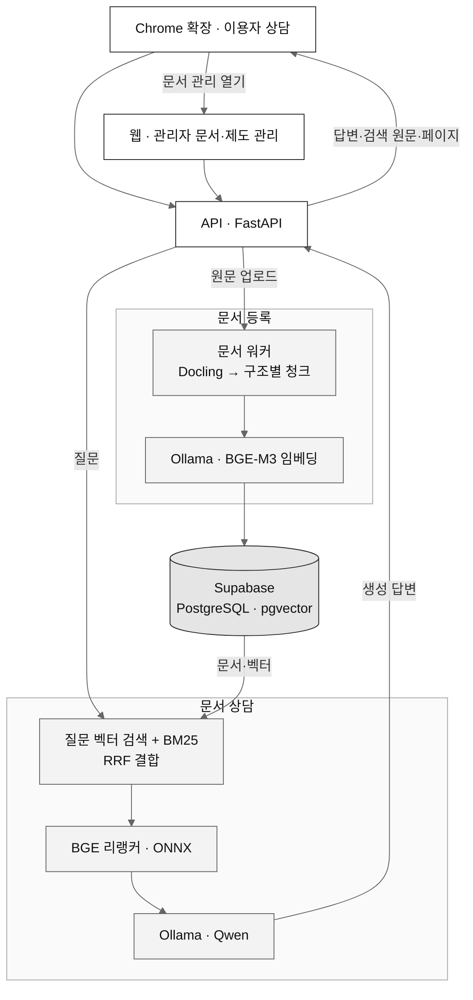

<div align="center">

<h1>곁에 | welfare_helper</h1>
<p><strong>공식 복지 문서에서 근거를 찾아 답하는 복지 길잡이</strong></p>
<p>문서 등록 → 자동 분석 → 원문 검색 → 근거와 함께 답변</p>

<p>
  
  
  
</p>

<p>
  <a href="#소개">소개</a> ·
  <a href="#기술-스택">기술 스택</a> ·
  <a href="#아키텍처">아키텍처</a> ·
  <a href="#로컬-빠른-시작">로컬 실행</a> ·
  <a href="#핵심-환경변수">환경변수</a> ·
  <a href="#문서-등록과-확인">문서 등록</a>
</p>

</div>

---

최신 업데이트: 2026-11-15 15:32 KST. main/b82b391의 설명을 코드와 대조했으며 운영 재시험은 하지 않았습니다.

## 소개

복지로 공개 화면의 Chrome 확장에서 조건을 입력하고, 공식 복지 문서를 검색해 상담받는 캡스톤 프로젝트입니다. 웹은 관리자 로그인·문서·제도 관리와 `/webchat`의 단발성 공개 상담을 제공합니다.

- **문서 관리:** PDF·DOCX·Markdown을 분석하고 구조별 청크와 검색 벡터를 자동으로 생성합니다.
- **문서 상담:** 벡터 검색과 키워드 검색을 결합해 관련 원문을 찾고, 답변과 확인된 기관·연락처를 보여주고 원문·페이지 참조는 내부 응답 계약으로 유지합니다.
- **이용자 편의:** 선택 조건·이전 상담·제한된 요약을 확장에 저장하고, 추천 질문·음성으로 전송할 초안을 작성합니다.

처음 이용할 때 조건 입력 또는 **나중에 입력** → 문서 상담 → 후속 질문·이전 상담 → 필요 시 **화면 안내** 순서로 사용합니다. [확장 실행·패키지 안내](Extension/README.md)를 참고하세요.

저장 프로필은 추천 질문 초안에 사용합니다. 정보 사용은 기본 OFF이며 현재 프로필 revision에 동의해 ON한 경우에만 나이·소득·가구·지역·장애 여부를 최종 생성에 제공합니다. 검색·검색 준비에는 보내지 않습니다. 직접 대화에서 말한 조건은 후속 질문 해석에 사용합니다. 조건·공개 상담·표시용 요약은 확장 전용 `chrome.storage.local`에 저장합니다. 화면 안내 이력은 메모리에 보관하고 확장에 관리자 토큰을 저장·전송하지 않습니다. 상담 전체는 DB에 저장하지 않으며 수집 ON 서버는 별도의 익명 연락처 안내 기록만 보관합니다. 화면 도움은 공개 DOM 기반이며 확장의 안내 모드에서 EC2 HTTPS로 요청합니다. 이미지 전송은 없습니다.

답변 정확성이나 최종 지원 자격은 보장하지 않습니다. 검색·생성·출처 표시의 현재 계약은 [RAG 설계](docs/design/rag.md)를 참고하세요. 과거 모델 시험 결과는 당시 입력과 설정에 한정되며 전체 서비스 품질로 확대하지 않습니다.

설계와 평가 자료의 위치는 [문서 목차](docs/README.md)를 참고하세요.

## 기술 스택

| 영역 | 기술 |
| :--- | :--- |
| 프런트엔드 | Chrome MV3 · React · TypeScript · Vite · Vitest |
| 백엔드 | Python 3.12 · FastAPI · pytest |
| 문서·AI | Docling · LangChain · Ollama/Qwen · BGE-M3 · ONNX BGE 리랭커 |
| 데이터·배포 | Supabase(PostgreSQL·pgvector) · Docker · EC2 · Vercel |

## 아키텍처



운영은 **Vercel(프런트) + EC2(Docker API·워커·Ollama) + Supabase(DB)**로 구성합니다.

공개 edge는 단순 `/health`와 기존 API를 제공하고 내부 진단·API 문서는 차단합니다. [운영 경계와 재현성](deploy/README.md)을 참고하세요.

## 로컬 빠른 시작

### 1. 준비와 저장소 받기

Git, Node.js/npm, 실행 중인 Docker Desktop(Compose 포함)이 필요합니다.

> **로컬 구성: 앱·모델은 내 PC, DB는 Supabase**
>
> 프로젝트 담당자에게 기존 DB 접속정보를 받고 스키마·부서 데이터가 준비됐는지 확인하세요. 앱은 테이블을 자동 생성하거나 로컬 PostgreSQL로 대체하지 않습니다.

```cmd
git clone https://github.com/jehee826/welfare_helper.git
cd welfare_helper
copy .env.example .env
```

Windows CMD 기준입니다. macOS/Linux에서는 마지막 명령 대신 `cp .env.example .env`를 사용합니다.

### 2. 환경 설정

루트 `.env`에 **`DATABASE_URL`·`DATABASE_PASSWORD`·`ADMIN_PASSWORD`**를 입력합니다. DB URL은 비밀번호를 뺀 Supabase Connect의 **Session pooler URI**, 비밀번호는 별도 값으로 설정합니다.

[.env.example](.env.example)은 EC2 GPU 기준이므로, 로컬에서는 아래 값으로 변경합니다.

```dotenv
OLLAMA_LLM=qwen2.5:1.5b-instruct
OLLAMA_RUNTIME=runc
LLM_NUM_THREAD=2
OLLAMA_TIMEOUT=600
VITE_API_BASE_URL=
```

EC2 GPU에서는 NVIDIA 드라이버·Container Toolkit을 준비하고 `docker-compose.yml`의 **GPU deploy 블록 주석을 해제**합니다. 모델 선택은 `OLLAMA_LLM`, GPU 장치 활성화는 이 별도 설정 단계로 구분합니다. CPU로 돌아갈 때는 GPU 블록을 다시 주석 처리하고 위 로컬 값으로 되돌립니다.

환경값을 바꾼 뒤에도 아래의 같은 Compose 명령을 사용합니다. 컨테이너가 재생성돼야 반영되며 단순 `restart`는 새 환경값을 주입하지 않습니다. 기존 모델·DB·캐시는 삭제하지 않습니다.

로컬에서는 `COMPOSE_PROFILES`를 설정하지 않습니다. `OLLAMA_EMBED=bge-m3`, `EMBED_DIM=1024`와 리랭커 리비전은 예시 그대로 유지합니다. 비밀값은 Git이나 `VITE_` 변수에 넣지 않습니다.

### 3. 백엔드와 프런트 실행

**터미널 A · 저장소 루트**

```cmd
docker compose up -d --build
docker compose ps
```

<details>
<summary>첫 실행은 모델 다운로드로 시간이 걸립니다</summary>

생성·임베딩 모델과 리랭커는 자동으로 준비합니다. 첫 PDF 처리에서는 Docling 모델도 추가로 내려받습니다.

설치된 모델은 재사용하며 없는 모델만 내려받습니다. 다운로드·캐시 준비가 실패하면 준비 완료로 처리하지 않습니다. 모델 변경 전 메모리·디스크와 네트워크를 확인하세요.

</details>

세 서비스가 healthy이고 [준비 상태](http://127.0.0.1:8000/health/ready)가 **200**인지 확인합니다. API 명세는 [Swagger](http://127.0.0.1:8000/docs)에서 볼 수 있습니다.

<details>
<summary>문서 RAG 설정·진단 확인</summary>

`/health/runtime`은 연결 검사 없이 지원 기능과 적용 설정을 보여줍니다. `/debug/rag`는 `/api/v1/chat`과 같은 QA를 한 번 실행하며, 별도 활성화·32자 이상 `X-Rag-Debug-Token`이 필요하고 Vercel에서는 차단됩니다. 비공개·테스트 자료에는 유효한 관리자 Bearer 세션도 필요합니다. 직접 사용자 발화와 최근 대화는 검색 의도이며 사실 근거는 이번 원문입니다. 호환용 옛 요약과 표시용 수동 요약은 검색·생성에 사용하지 않습니다. 같은 문서·버전의 관련 부모와 조건·예외를 함께 전달하고 예산이 부족하면 보류합니다. 응답 형식·참조 범위·문서 버전·개인정보 경계를 확인하지만 모든 주장의 의미나 최종 자격을 검증하지는 않습니다. 관련 근거 없음·조건 부족·복지 외 질문은 보류합니다. dense와 BM25 후보 모두 `min_similarity` 코사인 점수 하한을 통과해야 RRF 결합에 사용됩니다.

문서 요청의 전체 예산은 `OLLAMA_TIMEOUT`(최대 1800초)이며, 선택적 `timeout_seconds`(1~1800 정수)로 줄일 수 있습니다. 문서·화면 실행은 **프로세스당 3개·대기 0개**로 제한하고 혼잡은 429, 기한 초과는 504, 연결 종료 취소는 가능한 경우 499로 구분합니다. 요청 취소는 전송을 중단하며, 이미 실행 중인 DB·ONNX 작업의 즉시 종료를 보장하지 않습니다. native 작업이 끝날 때까지 다음 실행은 받지 않습니다. 다중 worker·문서 적재 프로세스에 걸친 전역 제한은 아닙니다.

리랭커 객체는 설정별 최대4개, 검증한 동일 스냅샷의 문서 BM25는 [제한된 인덱스1개](docs/design/rag.md#검색과-리랭커)를 재사용합니다. DB 스냅샷 검증·Python 유사도 계산은 요청마다 유지합니다. `ADMIN_CREDENTIALS_FILE`이 없는 환경에서는 `ADMIN_PASSWORD` 변경 후 백엔드 재생성이 필요합니다. 영속 인증이 활성화된 현재 EC2에서는 credential 파일이 기준이며 환경 비밀번호 변경으로 대체하지 않습니다. 관리자 웹의 재발급 절차와 기존 인증 볼륨을 유지합니다. Compose는 `docker compose up -d --force-recreate backend`로 환경값을 다시 주입하며, 단순 `restart`는 변경된 환경값을 반영하지 않습니다.

</details>

**터미널 B · 저장소 루트에서 시작**

```cmd
cd FrontEnd
npm ci
npm run dev
```

[관리자 문서 관리](http://localhost:5173/admin/documents)에 접속해 `ADMIN_PASSWORD`로 로그인합니다. `/`와 `/admin`도 이 화면으로 연결됩니다. Vite가 `/api` 요청을 로컬 백엔드로 전달합니다. 백엔드 코드 변경 후에는 같은 Compose 명령으로 재빌드합니다.

## 핵심 환경변수

- `DATABASE_URL` / `DATABASE_PASSWORD`: 기존 Supabase Session pooler의 비밀번호 없는 URI와 별도 DB 비밀번호.
- `ADMIN_PASSWORD`: 문서·제도 관리를 위한 서버 공통 관리자 비밀번호.
- `ADMIN_TRUSTED_PROXY_IPS`: 로그인·상담 제한 키에서만 신뢰할 실제 연결 프록시의 개별 IP JSON 목록, 기본 `[]`.
- `CHAT_RATE_LIMIT_PER_MINUTE`: 상담 API의 IP별 최근60초 요청 상한, 기본30·범위1~600·단일 프로세스 기준.
- `OLLAMA_LLM` / `OLLAMA_RUNTIME`: 생성 모델과 컨테이너 런타임(`runc` 또는 `nvidia`).
- `OLLAMA_EMBED` / `EMBED_DIM`: 문서·질문 임베딩 모델과 벡터 차원(`bge-m3` / `1024`).
- `LLM_NUM_THREAD` / `OLLAMA_TIMEOUT`: 생성 CPU 스레드 수와 서버 처리 상한(초), 확장 패키지 기본600초는 별도 설정.
- `VITE_API_BASE_URL`: 로컬은 빈 값, 운영은 `/api`를 제외한 HTTPS API 주소이며 변경 후 프런트 재빌드 필요.

전체 설정은 [.env.example](.env.example)을 참고합니다. 프런트와 Compose 모두 저장소 루트 환경파일을 사용합니다.

## 문서 등록과 확인

1. **문서 관리**에서 `ADMIN_PASSWORD`로 로그인합니다.
2. **제도 등록·관리**에서 준비된 부서를 선택해 제도를 등록하거나, 기존 제도를 사용합니다.
3. 연결할 제도를 고르고 **PDF·DOCX·UTF-8 Markdown** 원문을 업로드합니다.
4. 자동 분석·청크 생성·임베딩·**게시 완료**를 기다린 뒤 문서별 검색·질의로 원문을 확인합니다.
5. 이용자 상담은 Chrome 확장에서 질문하고 답변·기관·연락처를 확인합니다. 내부 원문 근거 대조는 승인된 관리자·진단 경로에서 수행합니다.

**로컬 업로드도 연결된 Supabase에 실제 저장됩니다.** `TEST_`/`test_only` 자료는 로그인한 관리자 상담에서만 확인할 수 있습니다.
