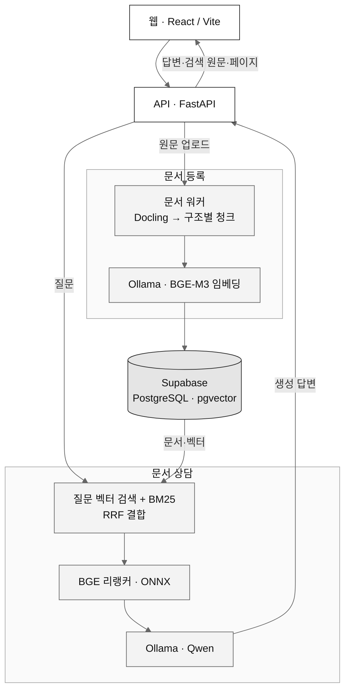

<div align="center">

<h1>곁에 | welfare_helper</h1>
<p><strong>공식 복지 문서에서 근거를 찾아 답하는 복지 길잡이</strong></p>
<p>문서 등록 → 자동 분석 → 원문 검색 → 근거와 함께 답변</p>

<p>
  
  
  
</p>

<p>
  <a href="#소개">소개</a> ·
  <a href="#기술-스택">기술 스택</a> ·
  <a href="#아키텍처">아키텍처</a> ·
  <a href="#로컬-빠른-시작">로컬 실행</a> ·
  <a href="#핵심-환경변수">환경변수</a> ·
  <a href="#문서-등록과-확인">문서 등록</a>
</p>

</div>

---

## 소개

복지서비스의 공식 원문을 등록하고, 이용자의 질문에 관련 문서를 검색해 답하는 캡스톤 프로젝트입니다.

- **문서 관리:** PDF·DOCX·Markdown을 분석하고 구조별 청크와 검색 벡터를 자동으로 생성합니다.
- **문서 상담:** 벡터 검색과 키워드 검색을 결합해 관련 원문을 찾고, 모델 답변과 원문·페이지를 함께 보여줍니다.
- **이용자 편의:** 조건·지난 상담·글자 크기를 같은 브라우저에 저장합니다.

원문에 없는 내용은 없다고 답하도록 설계했지만, 답변의 정확성이나 최종 지원 자격을 보장하지는 않습니다. VLM 화면 이해와 플로팅 UI는 향후 구현 범위입니다.

## 기술 스택

| 영역 | 기술 |
| :--- | :--- |
| 프런트엔드 | React · TypeScript · Vite · Vitest |
| 백엔드 | Python 3.12 · FastAPI · pytest |
| 문서·AI | Docling · LangChain · Ollama/Qwen · BGE-M3 · ONNX BGE 리랭커 |
| 데이터·배포 | Supabase(PostgreSQL·pgvector) · Docker · EC2 · Vercel |

## 아키텍처



운영은 **Vercel(프런트) + EC2(Docker API·워커·Ollama) + Supabase(DB)**로 구성합니다.

## 로컬 빠른 시작

### 1. 준비와 저장소 받기

Git, Node.js/npm, 실행 중인 Docker Desktop(Compose 포함)이 필요합니다.

> **로컬 구성: 앱·모델은 내 PC, DB는 Supabase**
>
> 프로젝트 담당자에게 기존 DB 접속정보를 받고 스키마·부서 데이터가 준비됐는지 확인하세요. 앱은 테이블을 자동 생성하거나 로컬 PostgreSQL로 대체하지 않습니다.

```cmd
git clone https://github.com/jehee826/welfare_helper.git
cd welfare_helper
copy .env.example .env
```

Windows CMD 기준입니다. macOS/Linux에서는 마지막 명령 대신 `cp .env.example .env`를 사용합니다.

### 2. 환경 설정

루트 `.env`에 **`DATABASE_URL`·`DATABASE_PASSWORD`·`ADMIN_PASSWORD`**를 입력합니다. DB URL은 비밀번호를 뺀 Supabase Connect의 **Session pooler URI**, 비밀번호는 별도 값으로 설정합니다.

[.env.example](.env.example)은 EC2 GPU 기준이므로, 로컬에서는 아래 값으로 변경합니다.

```dotenv
OLLAMA_LLM=qwen2.5:1.5b-instruct
OLLAMA_RUNTIME=runc
LLM_NUM_THREAD=2
OLLAMA_TIMEOUT=600
VITE_API_BASE_URL=
```

로컬에서는 `COMPOSE_PROFILES`를 설정하지 않습니다. `OLLAMA_EMBED=bge-m3`, `EMBED_DIM=1024`와 리랭커 리비전은 예시 그대로 유지합니다. 비밀값은 Git이나 `VITE_` 변수에 넣지 않습니다.

### 3. 백엔드와 프런트 실행

**터미널 A · 저장소 루트**

```cmd
docker compose up -d --build
docker compose ps
```

<details>
<summary>첫 실행은 모델 다운로드로 시간이 걸립니다</summary>

생성·임베딩 모델과 리랭커는 자동으로 준비합니다. 첫 PDF 처리에서는 Docling 모델도 추가로 내려받습니다.

</details>

세 서비스가 healthy이고 [준비 상태](http://127.0.0.1:8000/health/ready)가 **200**인지 확인합니다. API 명세는 [Swagger](http://127.0.0.1:8000/docs)에서 볼 수 있습니다.

**터미널 B · 저장소 루트에서 시작**

```cmd
cd FrontEnd
npm ci
npm run dev
```

[http://localhost:5173](http://localhost:5173)에 접속합니다. Vite가 `/api` 요청을 로컬 백엔드로 전달합니다. 백엔드 코드 변경 후에는 같은 Compose 명령으로 재빌드합니다.

## 핵심 환경변수

- `DATABASE_URL` / `DATABASE_PASSWORD`: 기존 Supabase Session pooler의 비밀번호 없는 URI와 별도 DB 비밀번호.
- `ADMIN_PASSWORD`: 문서·제도 관리를 위한 서버 공통 관리자 비밀번호.
- `OLLAMA_LLM` / `OLLAMA_RUNTIME`: 생성 모델과 컨테이너 런타임(`runc` 또는 `nvidia`).
- `OLLAMA_EMBED` / `EMBED_DIM`: 문서·질문 임베딩 모델과 벡터 차원(`bge-m3` / `1024`).
- `LLM_NUM_THREAD` / `OLLAMA_TIMEOUT`: 생성 CPU 스레드 수와 모델 요청 대기 시간(초).
- `VITE_API_BASE_URL`: 로컬은 빈 값, 운영은 `/api`를 제외한 HTTPS API 주소이며 변경 후 프런트 재빌드 필요.

전체 설정은 [.env.example](.env.example)을 참고합니다. 프런트와 Compose 모두 저장소 루트 환경파일을 사용합니다.

## 문서 등록과 확인

1. **문서 관리**에서 `ADMIN_PASSWORD`로 로그인합니다.
2. **제도 등록·관리**에서 준비된 부서를 선택해 제도를 등록하거나, 기존 제도를 사용합니다.
3. 연결할 제도를 고르고 **PDF·DOCX·UTF-8 Markdown** 원문을 업로드합니다.
4. 자동 분석·청크 생성·임베딩·**게시 완료**를 기다린 뒤 기본 채팅에서 질문합니다.
5. **원문 근거 보기**를 펼쳐 답변과 검색 원문·페이지를 대조합니다.

**로컬 업로드도 연결된 Supabase에 실제 저장됩니다.** `TEST_`/`test_only` 자료는 로그인한 관리자 상담에서만 확인할 수 있습니다.
