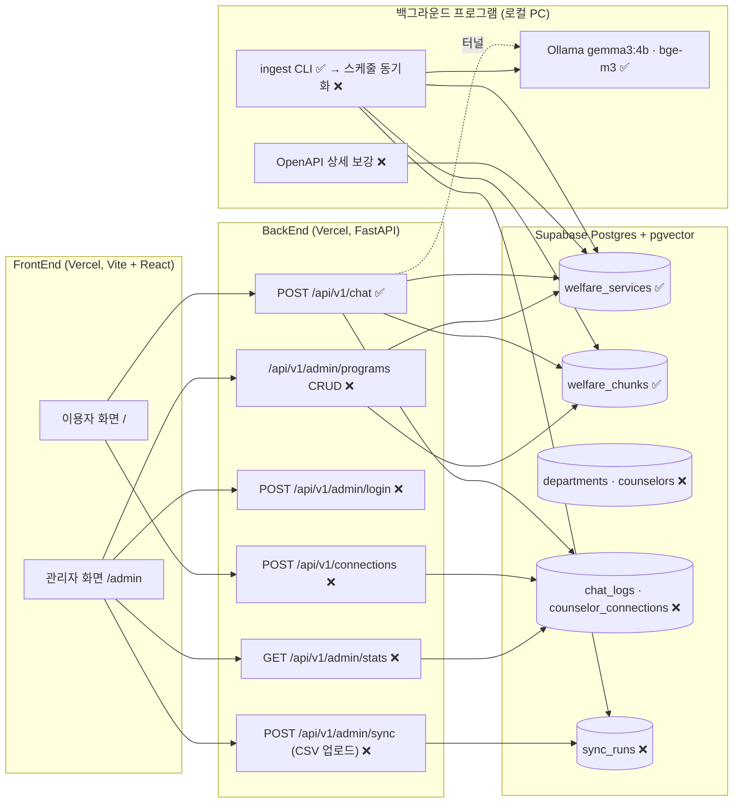

# 기획 문서 대비 구현 현황 갭 분석

- 작성일: 2026-10-27
- 비교 기준 문서: `docs/*.docx` 8종 (요구사항분석, 페르소나, 프로세스목록, 프로세스설계, 이벤트설계, 데이터설계 개념·논리·물리)
- 비교 대상 코드: `main` 브랜치 (`BackEnd/`, `FrontEnd/src/`, `vercel.json`, `docker-compose.yml`)

범례: ✅ 구현됨 · 🟡 일부 구현 · ❌ 미구현 · 🧪 목업만 있음(서버 연동 없음) · ⚠️ 문제 있음

---

## 0. 한눈에 보기

| 요구사항 | 내용 | 상태 | 가장 큰 부족점 |
|---|---|:-:|---|
| FR-1 | 회원가입 없이 조건 입력 후 맞춤 안내 | 🟡 | 조건 입력·저장은 되지만, 백엔드 검색 순위에 조건이 반영되지 않음 (답변 문장에만 쓰임) |
| FR-2 | 음성 입력 (고령층 접근성) | 🟡 | STT는 됨. 설계에 있는 "AI가 문장 다듬기" 단계가 없고, 답변 읽어주기(TTS)도 없음 |
| FR-3 | 버튼만으로 대화 | 🟡 | 추천 버튼 3개가 고정 문구이고, 그중 2개(신청 방법, 조건)는 누르면 항상 "자료 없음"으로 끝남 |
| FR-4 | 확신 없으면 담당자 연락처 안내·상담원 연결 | 🟡 | 환각 방지 가드는 잘 되어 있음. 상담원·부서 데이터가 없고, 상담원 연결 요청은 목업 |
| FR-5 | 과거 질문 이력 요약 | 🟡 | 사이드바는 있음. 요약이 제도명 나열 수준이고, 다른 기기(보호자)에서 볼 수 없음 |
| FR-6 | 관리자 로그인 (프로세스 06) | ⚠️ | 키를 브라우저에서 비교함. 키 값이 빌드된 JS 번들에 그대로 들어 있음 |
| FR-6 | 복지제도 최신화 (프로세스 07) | 🧪 | 관리자 화면 수정은 브라우저 localStorage에만 저장되고 DB·벡터에는 반영되지 않음. 실제 갱신은 CLI뿐 |
| 데이터 | 상담 기록 (질문, 안내 제도, 연계 여부, 일시) | ❌ | 서버에 저장하지 않음 |
| 데이터 | 상담원(담당자) 정보, 월별 연결 집계 | ❌ | 테이블 없음. 관리자 통계는 하드코딩된 목업 |
| 구성 | 백그라운드 프로그램 (별도) | 🟡 | `python -m BackEnd.ingest.run` 수동 CLI만 있음. 스케줄링·자동 수집·OpenAPI 보강 없음 |

**요약**: 이용자 채팅 흐름(FR-1~5)은 실제 RAG API로 동작합니다. 관리자 쪽(FR-6, 통계)과 서버 측 기록(상담 기록, 상담원 연결)은 아직 목업입니다.

---

## 1. 기능 요구사항별 비교

### FR-1 정보입력 (프로세스 01)

| 문서 요구 | 현재 구현 | 상태 |
|---|---|:-:|
| 나이·소득구간·가구형태·거주지 입력 | `ConditionForm.tsx`에서 입력, 장애 여부도 받음 | ✅ |
| 회원가입·로그인 없음 | 없음 | ✅ |
| 재방문 시 조건 불러오기 | `localStorage`(`welfare.profile`)에서 읽음 | ✅ |
| 입력값 유효성 검사 (이벤트 E3) | 나이 0~120만 프론트에서 검사, 백엔드 `ProfileIn`도 검사 | ✅ |
| 조건에 맞는 **맞춤** 안내 | 백엔드 `rag/chat.py`는 profile을 답변 문장과 LLM 프롬프트에만 넣고, **검색·순위에는 쓰지 않음**. 목업(`mockApi.ts`)에 있던 `profileBoost`가 실제 백엔드에는 없음 | 🟡 |
| 거주지 활용 | 데이터가 중앙부처 서비스뿐이라 거주지가 쓰이지 않음. 화면에 범위 안내도 없음 | ❌ |

**보충 제안**
- 검색 후 profile 기반 soft boost/penalty 추가 (목업의 `profileBoost` 로직을 `ChatService`로 이식). 예: 40세 이상인데 "청년" 제도가 뜨면 감점.
- 화면과 답변 하단에 "현재 중앙부처 복지서비스만 안내하며, 지자체 서비스는 주민센터에 문의" 고지.
- 소득 구간 매칭은 신청자격 데이터가 있어야 가능하므로 OpenAPI 보강(§3.3) 이후 진행.

### FR-2 음성채팅 (프로세스 02)

| 문서 요구 | 현재 구현 | 상태 |
|---|---|:-:|
| 음성 → 텍스트 (STT) | `useSpeechRecognition.ts` (브라우저 Web Speech API, `ko-KR`) | ✅ |
| AI가 문장을 다듬어 질문 확정 | 없음. 인식 결과를 입력창에 그대로 넣음 | ❌ |
| 인식 실패 시 재입력 안내 | 실패 횟수 집계, 듣는 중 안내 문구 | ✅ |
| 반복 실패 시 버튼 입력으로 전환 | 2회 실패 시 추천 버튼 강조 (`VOICE_FAILURE_LIMIT = 2`) | ✅ |
| 미지원 브라우저 대응 | 마이크 버튼이 조용히 사라짐 (Firefox 등). 안내 문구 없음 | 🟡 |

**보충 제안**
- 문장 다듬기: STT 결과를 그대로 보내되, 백엔드에서 구어체 질의를 검색용 문장으로 재작성하는 단계 추가 (FR-3 멀티턴 재작성과 같은 LLM 호출로 합칠 수 있음).
- 페르소나 이복순(65세, "텍스트를 보는 것이 어려움")에 맞춰 답변 **읽어주기(TTS, `speechSynthesis`)** 버튼 추가.
- 미지원 브라우저에서는 "이 브라우저는 음성 입력을 지원하지 않아요. 아래 버튼을 눌러 보세요" 표시.

### FR-3 추가질문 (프로세스 03)

| 문서 요구 | 현재 구현 | 상태 |
|---|---|:-:|
| 매 대화턴 버튼 또는 텍스트 선택 | `SuggestionChips` + 입력창 | ✅ |
| 사용자 정보 기반 맞춤 추천질문 (이벤트 E1) | 첫 화면만 나이·장애·한부모 기준 추천. 이후는 고정 문구 | 🟡 |
| AI가 예측한 다음 질문으로 버튼 갱신 | `_follow_ups()`가 항상 "`{제도명}` 신청 방법 / 받을 수 있는 조건 / 문의처" 3개를 만듦 | 🟡 |
| 버튼만 누르는 이용자도 같은 품질 답변 | ⚠️ "신청 방법"·"조건" 버튼은 CSV에 해당 데이터가 없어 **누르면 항상 연락처 안내(fallback)** 로 끝남 | ⚠️ |
| 이전 대화 맥락 이해 | 없음. 매 질문을 독립적으로 처리 ("그거 신청은요?" 처리 불가) | ❌ |
| 상담 이력 저장 (이벤트 E2) | 프론트 localStorage에만 저장 | 🟡 |

**보충 제안**
- 당장: 데이터가 없는 질문은 버튼으로 내지 않기. 대신 "비슷한 다른 제도", "복지로에서 자세히 보기", "담당 기관 전화번호" 같이 실제로 답할 수 있는 버튼으로 교체.
- OpenAPI 보강 후: 신청 방법·자격 버튼을 다시 살리고 실제 값으로 답변.
- 멀티턴: 요청에 최근 대화 2~3턴을 같이 보내고, 백엔드에서 독립 질문으로 재작성한 뒤 검색.

### FR-4 담당자 연락처 제공 (프로세스 04)

| 문서 요구 | 현재 구현 | 상태 |
|---|---|:-:|
| 추측 답변 금지 | 유사도 기준(`MIN_DENSE_SIM=0.52`) 미달 시 LLM 호출 없이 fallback | ✅ |
| LLM 환각 차단 | 자료에 없는 전화번호·숫자(금액·나이 등)가 나오면 템플릿 문장으로 교체. 시스템 프롬프트로 단정 금지 | ✅ |
| RAG 검색 (이벤트 E1) | 서비스명 직접 매칭(pin) + pgvector 코사인 검색, Ollama 장애 시 키워드 검색 | ✅ |
| 검색 결과가 없거나 모호할 때 **관련 부서** 연락처 | 결과가 없으면 129(보건복지상담센터)만 안내. "모호함"(1·2위 점수 차가 작음 등)은 판정하지 않음 | 🟡 |
| 상담원(담당자) 정보: 담당 부서, 이름, 연락처 | 없음. CSV의 "대표문의" 문자열을 파싱해서 사용 | ❌ |
| 상담원 연결 | `FallbackCard`의 "상담원 연결 요청" 버튼은 화면 문구만 바뀜 (목업) | 🧪 |
| 월별 연결 건수 집계 | 없음 | ❌ |

**보충 제안**
- `departments`, `counselors`, `counselor_connections` 테이블 추가 (데이터 설계 물리 ERD 그대로).
- "상담원 연결 요청" → `POST /api/v1/connections`로 기록. 집계는 `counselor_connections`를 월별 `GROUP BY`하는 뷰로 계산.
- 결과 없음 fallback에서도 dense 검색 상위 1~2건(기준 미달)의 대표문의를 "관련 있을 수 있는 기관"으로 함께 보여주기 (목업에는 이 동작이 있었음).

### FR-5 채팅 요약본 제공 (프로세스 05)

| 문서 요구 | 현재 구현 | 상태 |
|---|---|:-:|
| 우측 사이드바에서 과거 대화 확인 | `HistorySidebar.tsx` (모바일은 드로어) | ✅ |
| 질문별 요약 카드 | 질문 + "`제도명들` 안내" 한 줄 | 🟡 |
| 원문 펼쳐 보기 | `<details>`로 답변 텍스트 표시 | ✅ |
| 이력 없으면 안내 후 종료 | "아직 상담 기록이 없어요" | ✅ |
| 보호자(이상엽)가 할머니의 이력 확인 | 같은 기기·같은 브라우저에서만 볼 수 있음 | ❌ |

**보충 제안**
- 이력에 답변 텍스트만이 아니라 안내된 제도 카드(이름, 연락처, 복지로 링크)도 저장해서 다시 볼 수 있게 하기.
- 보호자용 **인쇄 / 공유 링크 / 텍스트 복사** 기능. 서버에 저장하지 않는 방식(클립보드 복사, 인쇄용 화면)을 먼저 검토.

### FR-6 관리자 로그인 (프로세스 06)

| 문서 요구 | 현재 구현 | 상태 |
|---|---|:-:|
| 암호화 키 입력으로 관리자 페이지 진입 | `AdminLogin.tsx`가 `VITE_ADMIN_DEMO_KEY`와 브라우저에서 비교 | ⚠️ |
| 키 불일치 시 재입력 | 됨 | ✅ |
| 삭제 권한이 있는 경로만 잠금 | 화면만 잠기고 API 권한 검사는 없음 (관리자 API 자체가 없음) | ❌ |

> ⚠️ **보안 이슈**: `VITE_` 환경변수는 빌드 시 JS 번들에 그대로 들어갑니다. 확인 결과 현재 `FrontEnd/dist/assets/*.js`에 관리자 키 값이 들어 있고, 키 길이도 4자로 짧습니다. 배포본을 연 누구나 키를 볼 수 있으니 **키를 즉시 교체(rotate)** 하고, 서버 측 인증으로 옮겨야 합니다.

**보충 제안**
- 백엔드 `POST /api/v1/admin/login`에서 `.env`의 `ADMIN_KEY`(해시)와 비교하고, 짧은 만료의 httpOnly 쿠키나 토큰 발급.
- 모든 `/api/v1/admin/*`에 인증 의존성(`Depends`) 적용. 로그인 실패 횟수 제한.
- 프론트 `.env`에서 `VITE_ADMIN_DEMO_KEY` 제거.

### FR-6 최신 복지제도 최신화 (프로세스 07)

| 문서 요구 | 현재 구현 | 상태 |
|---|---|:-:|
| 복지로 최신 자료 받아 관리자 페이지에 파일 업로드 | 업로드 UI 없음. CLI `python -m BackEnd.ingest.run --csv 경로`로만 가능 | ❌ |
| 기존 벡터 삭제 → 새 자료 벡터화·등록 | CLI의 `replace_all()`이 upsert 후 스냅샷에 없는 서비스를 삭제 (한 트랜잭션) | ✅ (CLI) |
| 개별 제도 수정·삭제·추가 | `ProgramManager.tsx`에 있지만 **localStorage에만 저장** (`welfare.mock.programs`) | 🧪 |
| 관리자 목록 = 실제 챗봇 데이터 | ⚠️ 목록은 `programs.json` 시드 20건, 실제 DB는 367건 | ⚠️ |
| 샘플 질문으로 반영 확인 | 실제 백엔드 `/api/v1/chat`에 물어봄. 그런데 관리자 수정은 DB에 없으므로 **수정 내용이 확인 결과에 나오지 않음** | ⚠️ |

**보충 제안**
- 관리자 API: 제도 CRUD(저장 시 해당 청크 재임베딩), CSV 업로드 → dry-run 결과(추가·변경·삭제 건수) 확인 → 적용.
- 관리자가 직접 수정한 행은 다음 CSV 동기화 때 덮어쓰거나 지우지 않도록 `source`(`csv` / `admin`) 또는 `locked` 컬럼 추가.
- 대량 삭제 방지: 새 CSV가 기존 대비 20% 이상 줄면 적용 중단 (`welfare-rag-pipeline-design.md` §7.5에 이미 설계됨).

---

## 2. 프로세스·이벤트 설계 대비

| # | 프로세스 | 이벤트 | 구현 위치 | 상태 | 빠진 단계 |
|---|---|---|---|:-:|---|
| 01 | 정보입력 | E1 사용자 정보 확인, E2 불러오기, E3 조건 대조·저장 | `UserPage.tsx`, `ConditionForm.tsx` | 🟡 | 이벤트 설계의 "쿠키 uuid로 DB 조회·저장"은 구현 안 함 (§5 문서 불일치 1 참고) |
| 02 | 음성채팅 | (이벤트 없음) | `useSpeechRecognition.ts`, `ChatPanel.tsx` | 🟡 | AI 문장 다듬기 |
| 03 | 추가질문 | E1 추천질문 제공, E2 이력 저장 | `SuggestionChips.tsx`, `rag/chat.py`, `lib/history.ts` | 🟡 | 맞춤 추천, 서버 측 이력 저장 |
| 04 | 담당자 연락처 | E1 RAG 검색, E2 상담자 번호 제공 | `rag/chat.py`, `FallbackCard.tsx` | 🟡 | 상담사 DB 조회, 연결 기록, 월별 집계 |
| 05 | 채팅 요약본 | (이벤트 없음) | `HistorySidebar.tsx` | ✅ | 보호자 공유 (페르소나 요구) |
| 06 | 관리자 로그인 | (이벤트 없음) | `AdminLogin.tsx` | ⚠️ | 서버 인증 |
| 07 | 복지제도 최신화 | (이벤트 없음) | `ingest/run.py`(CLI), `ProgramManager.tsx`(목업) | 🧪 | 파일 업로드, 관리자 API, 반영 확인 |

이벤트 설계서에는 02·05·06·07 프로세스의 이벤트 표가 비어 있습니다. 구현 전에 아래 이벤트를 추가해 두면 API 설계가 쉬워집니다.

| 프로세스 | 추가할 이벤트 예시 |
|---|---|
| 02 | STT 결과 수신 → 질문 재작성 / 인식 실패 N회 → 버튼 강조 |
| 05 | 사이드바 열기 → 이력 조회 / 이력 삭제 |
| 06 | 키 제출 → 서버 검증 → 세션 발급 / 실패 N회 → 잠금 |
| 07 | 파일 업로드 → 검증·dry-run 리포트 / 적용 승인 → 재임베딩 → 동기화 이력 기록 |

---

## 3. 데이터 설계 대비

### 3.1 ERD(물리) ↔ 현재 스키마(`BackEnd/db/schema.sql`)

| ERD 테이블 | 현재 테이블 | 상태 | 차이 |
|---|---|:-:|---|
| `departments` (소속 부서) | 없음 | ❌ | `welfare_services.department`에 텍스트로만 있음 |
| `welfare_programs` (복지제도 정보) | `welfare_services` | 🟡 | `eligibility`, `benefit_details`, `application_method` 없음 (CSV에 원래 없음). `department_id` FK 대신 `ministry`/`department` 텍스트. 대신 `url`, `contacts(JSONB)`, `source_updated_at`, `synced_at` 있음 |
| `welfare_document_vectors` | `welfare_chunks` | ✅ | `vector(1024)`로 차원 확정, `embed_model` 기록. `source_reference`는 `welfare_services.url`로 대체. 서비스당 청크 1개 |
| `counselors` (상담사 정보) | 없음 | ❌ | |
| `counselor_connections` (연결 내역) | 없음 | ❌ | |
| 사용자 정보 (개념 설계) | 없음 (브라우저 localStorage) | — | 논리·물리 ERD에서도 빠져 있음 (§5 참고) |
| 상담 기록 (데이터 요구사항) | 없음 | ❌ | ERD에도 테이블이 없음 |

### 3.2 추가가 필요한 테이블 제안

```text
departments          (department_id PK, department_name)
counselors           (counselor_id PK, counselor_name, department_id FK, phone_number)
welfare_services     + department_id FK, eligibility, benefit, how_to_apply, source('csv'|'admin'|'openapi')
welfare_chunks       + section('overview'|'target'|'criteria'|'benefit')   -- 보강 시 서비스당 여러 청크
chat_logs            (log_id PK, session_id(익명 uuid), question, answer_kind, service_ids[], created_at)
counselor_connections(connection_id PK, counselor_id FK NULL, department_id FK NULL, log_id FK, status, requested_at, confirmed_at)
sync_runs            (run_id PK, source_file, added, updated, removed, status, started_at, finished_at)
```

- `chat_logs`에는 **나이·소득 등 profile을 저장하지 않습니다**. 통계에 필요한 것은 질문, 안내된 제도, 연계 여부, 일시뿐입니다 (요구사항 데이터 항목과 같음).
- 월별 집계는 별도 테이블 대신 `counselor_connections`·`chat_logs`를 월 단위로 묶는 뷰로 만듭니다. 원본 로그가 있어야 다른 기준으로도 다시 집계할 수 있습니다.

### 3.3 데이터 소스 한계

CSV(367건)에는 신청자격·지원내용·신청방법이 없습니다 (`docs/welfare-rag-features.md` §0). 이 때문에

- FR-1의 "조건에 맞는지" 판단이 불가능하고,
- FR-3의 "신청 방법 / 조건" 버튼이 항상 fallback이 됩니다.

`중앙부처복지서비스` OpenAPI 상세조회(`servId=WLF…`)로 보강하는 단계(`welfare-rag-pipeline-design.md` §4.3, Step 4)가 설계만 되어 있고 구현되지 않았습니다. 다른 여러 기능이 이 보강에 의존하므로 우선순위가 높습니다.

---

## 4. 비기능·제약사항 점검

| 항목 | 근거 문서 | 현재 | 상태 | 보충 |
|---|---|---|:-:|---|
| 환각 방지 최우선 | 요구사항 제약사항 | 유사도 기준, 숫자·전화번호 검증, 프롬프트 규칙, LLM 실패 시 템플릿 | ✅ | 평가용 질문 세트(golden set)로 기준값 0.52 검증 필요 |
| 고령층 접근성 | 요구사항, 페르소나 이복순 | 글자 크게, 음성 입력, 버튼 대화 | 🟡 | TTS, 더 큰 버튼, 고대비 모드 |
| 민감정보 보관 신중 | 요구사항 "확인 필요" | profile은 localStorage, 서버는 요청마다 받기만 하고 저장 안 함 | ✅ | 개인정보 처리 안내·동의 문구 없음. profile이 터널을 거쳐 로컬 PC의 Ollama까지 전달됨을 고지 |
| 관리자 보안 | 프로세스 06 | 클라이언트 키 비교, 번들 노출 | ⚠️ | §1 FR-6 로그인 참고 |
| 서비스 가용성 | (암묵적) | Ollama가 개인 PC + 터널. 임베딩 실패 시 키워드 검색, LLM 실패 시 템플릿으로 자동 대체 | 🟡 | `/health/llm` 엔드포인트, 터널 주소 변경 시 대응 절차 |
| 남용 방지 | (암묵적) | 없음 | ❌ | `/api/v1/chat` 요청 수 제한 (IP당 분당 N회) |
| 테스트 | CLAUDE.md (pytest) | pytest 31개 (API·채팅·CSV·텍스트), Vitest 5개 파일 | 🟡 | 관리자 API·연결 기록이 생기면 함께 테스트. 검색 품질 평가 스크립트 없음 |

---

## 5. 기획 문서끼리 맞지 않는 부분 (팀 결정 필요)

| # | 내용 | 권장 결정 |
|---|---|---|
| 1 | **이용자 정보 저장 위치**: 요구사항은 "설계 단계에서 신중히 결정", 프로세스 설계는 "쿠키 + LocalStorage, DB 없음", 이벤트 설계 E2·E3은 "쿠키 uuid로 **DB** 조회·저장" | 현재 구현대로 **LocalStorage만** 사용 (민감정보를 서버에 두지 않음). 이벤트 설계 E2·E3과 개념 ERD의 "사용자 정보" 테이블을 이에 맞게 수정 |
| 2 | 개념 설계에는 "사용자 정보" 테이블이 있는데 논리·물리 ERD에는 없음 (문서 안에도 지적됨) | 1번 결정에 따라 개념 설계에서 제거하고 사유 기록 |
| 3 | "상담사 월별 연결 집계"(개념) → "counselor_connections 연결 건별 로그"(논리·물리) | **건별 로그 + 월별 집계 뷰**. 문서를 건별 로그 기준으로 통일 |
| 4 | 데이터 요구사항의 "상담 기록"에 대응하는 테이블이 ERD에 없음 | `chat_logs` 추가 (§3.2) |
| 5 | ERD의 `eligibility`, `benefit_details`, `application_method`는 CSV에 없는 값 | OpenAPI 보강을 데이터 출처로 명시 |
| 6 | 프로세스 07 "기존 벡터 삭제 → 등록"과 현재 구현 "upsert + 스냅샷에 없는 것 삭제" | 현재 방식이 중간 실패에 안전하므로 설계 문서를 현재 방식으로 수정 |
| 7 | 팀장 이름: 요구사항분석서 "김은정", 페르소나 "김은경" | 하나로 통일 |
| 8 | 이벤트 설계서에 02·05·06·07 이벤트 표가 비어 있음 | §2 표의 예시로 채우기 |

---

## 6. 목표 구조



### 백그라운드 프로그램이 맡을 일

현재 `BackEnd/ingest/run.py`는 사람이 직접 실행하는 CLI입니다. "백그라운드 프로그램 : 별도" 방향에 맞추려면 아래가 필요합니다.

1. **OpenAPI 보강 수집**: 서비스아이디로 상세조회, 원본 캐시(`data/cache`)에 저장, 일일 호출 한도 대비 이어받기.
2. **변경분만 재임베딩**: 청크 텍스트 hash와 임베딩 모델명을 비교해 바뀐 것만 다시 임베딩.
3. **관리자 업로드 처리**: 웹에서 올린 CSV를 큐(또는 `sync_runs`의 `pending` 상태)로 받아 Ollama가 있는 로컬 PC에서 처리. Vercel 함수에서는 Ollama 임베딩을 오래 돌리기 어렵기 때문입니다.
4. **동시 실행 방지**: PostgreSQL advisory lock.
5. **실행 기록과 실패 알림**: `sync_runs`에 결과 저장, 관리자 화면에서 확인.
6. **주기 실행**: Windows 작업 스케줄러 등으로 하루 1회.

---

## 7. 우선순위 로드맵

### P0: 시연 전 필수

| 작업 | 관련 | 이유 |
|---|---|---|
| 관리자 키 교체(rotate) + 서버 측 인증으로 이전 | FR-6 | 키가 배포 번들에 노출됨 |
| 관리자 제도 목록·수정을 실제 DB와 연결 (CRUD API + 재임베딩) | FR-6 | 지금은 수정해도 챗봇에 반영되지 않고, 목록도 실제 데이터(367건)와 다름 |
| 추천 버튼에서 "항상 fallback"인 질문 제거·교체 | FR-3 | 버튼만 쓰는 고령 이용자가 막다른 길을 만남 |
| "중앙부처 서비스만 안내" 범위 고지 | FR-1 | 거주지를 입력받지만 쓰지 않음 |
| 정리: `BackEnd/scripts/`(캐시 파일만 남은 폴더) 삭제 | — | 추적되지 않는 잔여물 |

### P1: 핵심 기능 완성

| 작업 | 관련 |
|---|---|
| OpenAPI 상세 보강 (신청자격·지원내용·신청방법) + 섹션 청크 | FR-1, FR-3, 데이터 |
| `chat_logs`, `counselor_connections` 저장 + 실제 월별 통계 | FR-4, 페르소나 김은경 |
| `departments`, `counselors` 데이터와 상담원 연결 요청 API | FR-4 |
| profile 기반 검색 순위 보정 | FR-1 |
| CSV 업로드 → dry-run → 적용 (관리자 화면) | FR-6, 프로세스 07 |
| 결과 없음 fallback에 관련 기관 연락처 추가 | FR-4 |

### P2: 품질·편의 개선

| 작업 | 관련 |
|---|---|
| 멀티턴 질문 재작성 (+ STT 문장 다듬기 통합) | FR-2, FR-3 |
| 답변 읽어주기(TTS), 미지원 브라우저 안내 | FR-2 |
| 이력 인쇄·복사·공유, 이력에 제도 카드 저장 | FR-5, 페르소나 이상엽 |
| 백그라운드 스케줄 동기화, 변경분만 재임베딩 | FR-6 |
| 검색 품질 평가 세트와 기준값 재보정 | 환각 방지 |
| 요청 수 제한, `/health/llm` | 가용성 |
| 개인정보 처리 안내 문구 | 민감정보 |
