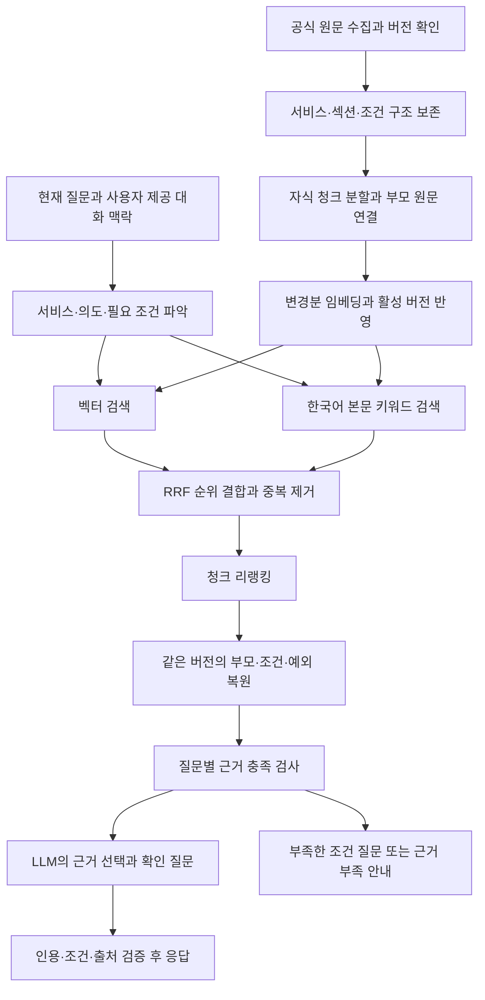

# 공식 복지 정보 RAG 정확도 설계

## 1. 목적과 적용 범위

정부기관 자료에서 질문에 필요한 근거를 찾고, 적용 조건·예외·시점을 보존한 답변을 제공한다. 응답 속도보다 사실 정확성을 우선하며, 충분한 근거가 있는 질문에는 답하고 부족한 부분만 확인하거나 보류한다.

이 문서는 2026-10-24 기준 코드 검토에 따른 후속 설계다. 아래의 신규 분할·검색·검증 기능과 수치는 구현 완료나 성능 검증 결과가 아니다. 수치는 실제 공식 원문과 수동 평가 결과로 조정할 초기값이다. RAG와 출처 표시만으로 모든 질문에서 환각이 사라진다고 보장하지 않는다.

실행은 두 장비 모두 `docker compose up -d --build`를 사용한다. 생성 모델은 `OLLAMA_LLM`만 변경하고, 장비별 코드·Compose·모드는 추가하지 않는다. Supabase와 기존 ERD, `bge-m3` 임베딩의 1024차원을 유지한다. 프런트엔드와 공개 API 계약 변경은 이 설계의 기본 범위에 포함하지 않는다.

기존 [파이프라인 설계서](welfare-rag-pipeline-design.md)와 [피처 선별표](welfare-rag-features.md)는 초기 구상과 데이터 설명으로 참고한다. 이 문서는 후속 정확도 개선안이며, 이전 문서의 구현 상태·경로·500자 분할·서비스 집계 Top 5·스트리밍 구상을 현재 구현 사실로 취급하지 않는다.

## 2. 현재 동작과 정확도 병목

현재 CSV는 서비스명·분류·요약을 합쳐 서비스당 overview 한 개를 만든다. 앞선 DB 확인에서는 367개 서비스와 367개 청크가 있었고, 본문은 최소 67자·평균 107.4자·최대 161자였다. 이 수치는 과거 확인값이며 이 문서 작성 중 DB를 다시 조회한 결과는 아니다. 짧은 요약에는 상세 자격·금액·절차가 없으므로 분할 방식만 바꿔 해결할 수 없다.

코드에서 확인한 주요 제약은 다음과 같다.

1. `BackEnd/ingest/official.py`는 공식 상세의 섹션 전체를 청크 한 개로 만들며, 고정 청크 크기·오버랩이 없다. 지원내용·신청 섹션에는 대상·선정기준 전체를 붙인다.
2. `BackEnd/rag/evidence.py`의 상세 임베딩 텍스트에는 섹션·본문·조건이 들어가지만 서비스명은 포함되지 않는다. 서로 다른 서비스의 공통 조건이 임베딩을 지배할 수 있다.
3. `BackEnd/rag/chat.py`의 키워드 검색은 서비스명·요약·담당 부서를 사용한다. 상세 본문의 정확한 용어나 신청 절차는 키워드 검색 대상이 아니다.
4. 키워드 서비스 ID를 앞에 놓고 후보 수로 자른 뒤 조건을 조회한다. 벡터 검색에서 찾은 청크 자체는 남더라도 해당 서비스의 필수 조건은 보완 조회에서 빠질 수 있다.
5. `BackEnd/rag/reranker.py`는 질문·문서 쌍을 512토큰으로 제한하고 문서 쪽을 자른다. 긴 본문의 뒤쪽 단서·예외가 점수 계산에서 빠질 수 있다.
6. `RETRIEVE_TOP_N=12`가 여러 단계의 제한에 함께 쓰인다. 서비스 카드 한도 3개와 근거 선택 개수도 연결돼 있어, 한 서비스의 여러 필수 근거를 충분히 고르기 어렵다.
7. `chunks_for_services()`는 여러 서비스의 청크를 합쳐 최대 500행만 읽는다. 상세 청크가 늘면 필수 섹션이 잘렸는지 구분할 수 없다.
8. 상세 적재는 받은 섹션만 갱신하고 빠진 섹션은 보존한다. 변경·폐지된 조건이 계속 검색되는 것을 막을 버전 활성화 규칙이 필요하다.
9. 현재 인용 검증은 원문 문장과의 일치를 확인한다. 실제 질문에 답하는지, 필수 예외가 함께 제시됐는지, 현재 유효한지는 별도 검증이 필요하다.

## 3. 전체 처리 흐름



리랭킹은 후보의 순서를 개선한다. 처음 검색에서 누락된 자료를 찾아내거나, 원문에 없는 정보를 채우거나, 제도의 현재 유효성을 보증하는 역할은 아니다.

## 4. 공식 원문과 버전 관리

### 4.1 수집 대상

우선 같은 서비스 ID로 지원대상, 선정기준, 지원내용, 신청방법을 확보한다. 문의처·출처 URL·기준연도·원문 수정일·수집 시각은 별도로 보존한다. 현재 공식 API 어댑터가 실제 XML의 필드와 반복 항목을 올바르게 해석하는지는 실제 응답으로 확인해야 한다.

자료의 최신성을 확인할 때 수집 시각과 정책 적용 시점을 구분한다. 오늘 수집한 2025년 자료를 2026년 현행 제도라고 설명하지 않는다. 적용 시점이 불명확하면 자료 기준만 밝히고 현재 동일하다고 단정하지 않는다. 공식 문서끼리 충돌하면 수집일이 늦다는 이유만으로 한쪽을 정답으로 선택하지 않는다.

질의 처리 중 임의의 웹 페이지를 실시간으로 가져와 답변 근거에 섞지 않는다. 우선 검토·적재된 공식 자료로 답하며, 자료 갱신은 별도 수집 작업으로 관리한다.

### 4.2 원문 정제

- HTML 장식과 불필요한 공백은 정리하되 문단·목록·표의 의미는 보존한다.
- `이상/초과/이하/미만`, `및/또는`, `다만/제외/단`, 부정 표현과 수치 단위를 제거하지 않는다.
- 표는 행 이름·열 이름·단위·각주를 함께 읽을 수 있는 텍스트로 변환한다. 금액만 남기거나 다른 열의 조건과 결합하지 않는다.
- 출처에 없는 대상 연령·금액·효력일을 추론하여 메타데이터에 채우지 않는다.
- 원문 정제본과 검색용 정규화 텍스트를 구분한다. 인용은 정제 원문으로 검증하며, 형태소 분석이나 검색 별칭으로 원문을 바꾸지 않는다.

### 4.3 활성 버전과 증분 반영

서비스 단위의 완전한 수집 결과를 검증하고 임베딩을 준비한 다음, 하나의 DB 트랜잭션으로 새 버전을 활성화하고 이전 버전을 검색 대상에서 제외한다. 네트워크 오류·응답 일부 누락·빈 결과를 제도 폐지로 판단하지 않는다. 일부 섹션이 빈 이유를 확인하지 못했다면 기존 활성본을 유지하고 수집 실패로 처리한다.

원문 해시, 정제 버전, 분할 버전, 실제 임베딩 입력, 임베딩 모델 식별자를 비교하여 바뀐 청크만 재임베딩한다. 수집 시각만 바뀌면 벡터를 다시 만들 필요가 없다. 생성 LLM만 바꾸어도 재임베딩하지 않는다. 동일 태그의 임베딩 모델 가중치가 바뀌는 경우를 감지할 수 있도록 모델 digest 또는 동등한 버전 식별자도 기록한다.

부모·자식·필수 조건 조회는 동일 서비스·동일 원문 버전을 사용한다. 요청 도중 활성 버전이 바뀌어 일관된 근거를 얻지 못하면 전체 검색을 한 번 재시도하고, 다시 충돌하면 답변을 보류한다.

## 5. 청크 글자 수와 토큰 한도

### 5.1 초기 분할 설정

| 항목 | 초기 설계값 | 적용 기준 |
|---|---|---|
| 본문 목표 길이 | 600자 | 문단·문장 경계를 우선하며 길이를 억지로 채우지 않음 |
| 본문 최대 길이 | 800자 | 오버랩 포함, 서비스명·섹션 헤더는 별도 |
| 자식 입력 토큰 상한 | 400토큰 | 리랭커 tokenizer 기준, 서비스명·섹션·본문·오버랩 포함 |
| 오버랩 | 완결 문장 최대 1개, 80자 및 40토큰 이내 | 같은 긴 섹션 안에서만 적용, 두 상한 모두 만족 |

글자 수는 NFC 정규화와 공백 정리 후 Python `len()`에 해당하는 Unicode 코드 포인트 수로 센다. 공백·줄바꿈·문장부호도 포함하며 UTF-8 바이트 수를 글자 수로 사용하지 않는다. 한국어 몇 자가 몇 토큰인지는 고정 비율로 환산하지 않는다.

600자는 의미 단위를 묶는 목표이고, 800자와 400토큰은 둘 다 지켜야 하는 상한이다. 예를 들어 본문이 650자여도 헤더를 포함해 400토큰을 넘으면 더 나눈다. 250자의 완결된 지원대상 섹션을 다른 섹션과 합쳐 600자로 만들지는 않는다. 기존 67~161자 CSV overview는 그대로 한 청크로 유지하고 오버랩을 두지 않는다.

이 수치는 현재 512토큰 리랭커 입력에 여유를 두기 위한 출발점이다. 최적값이라고 주장하지 않으며, 글자 수와 토큰 수의 실제 분포는 공식 상세를 확보한 뒤 확인한다.

### 5.2 분할 순서와 예외

분할 순서는 서비스 → 원문 버전 → 섹션 → 문단·목록 항목·표 행 묶음 → 문장이다. 서로 다른 서비스·연도·지원대상/선정기준/지원내용/신청방법 섹션을 한 자식 청크에 섞지 않는다.

`지원한다. 다만 …는 제외한다.`처럼 본문과 예외가 연결되면 같은 논리 단위로 표시한다. 가능하면 함께 담고, 상한을 넘어서 나눠야 하면 원문 범위와 필수 연결 ID를 보존해 답변 구성 단계에서 반드시 함께 조회한다. 접속사만 보고 모든 예외 관계를 자동 확정하지 않으며, 관계를 확정할 수 없는 자료는 부모 섹션 전체를 필수 근거로 취급한다.

문장 하나가 상한보다 길면 목록·절 경계를 이용하고, 그래도 불가능한 경우 토큰 한도에 맞춰 조각내되 `완결 근거 아님`으로 표시한다. 이런 조각은 검색에는 사용할 수 있어도 단독으로 자격·금액의 최종 근거가 될 수 없다. 연결된 완전한 원문을 복원하지 못하면 보류한다.

LangChain의 `RecursiveCharacterTextSplitter`는 문단·줄바꿈 등 경계와 길이 기준을 설정하는 도구로 활용할 수 있다. 다만 기본 설정만으로 복지 조건·표·예외의 논리 관계를 보존한다고 가정하지 않는다. 구조 분석과 토큰 한도 검사를 앞뒤에 둔다. [공식 분할 문서](https://docs.langchain.com/oss/python/integrations/splitters/recursive_text_splitter)

### 5.3 오버랩을 적용하는 정확한 조건

같은 긴 섹션을 연속으로 나눌 때 앞 청크의 마지막 완결 문장 한 개가 80자와 40토큰 이내이면 다음 청크에 포함한다. 문장이 한도를 넘으면 일부만 잘라 겹치지 않고, 부모·인접 범위 연결로 보완한다. 따라서 실제 오버랩은 0~80자이며 항상 80자가 아니다.

오버랩은 경계의 문맥을 보완하는 장치다. 멀리 떨어진 예외나 다른 섹션의 선정기준까지 가져오는 역할은 부모·조건 연결이 담당한다. 겹침을 크게 늘려 같은 문장이 검색 결과를 채우지 않도록 같은 원문 범위는 컨텍스트와 최종 응답에서 한 번만 사용한다.

가상의 설명용 자료가 `A와 B를 모두 충족해야 지원한다. 다만 C에 해당하면 제외한다.`라면, A만 검색됐다는 이유로 지원 가능하다고 답하면 안 된다. 실제 복지 제도의 자격을 예시로 추정하지 않고 이러한 논리 보존 자체를 평가한다.

## 6. 부모 원문과 저장 형식

검색용 자식 청크는 작게 만들고, 답변에는 같은 버전의 부모 섹션과 연결된 조건을 복원한다. 부모 크기는 고정 2,000자 등으로 자르지 않고 논리 섹션을 보존한다. 다만 부모가 크다고 무조건 전체를 LLM에 보내지 않으며, 아래 컨텍스트 예산과 필수 조건 충족 검사를 적용한다. [LangChain의 부모 문서 검색 개념](https://reference.langchain.com/python/langchain-classic/retrievers/parent_document_retriever/ParentDocumentRetriever)

ERD를 유지하기 위해 기존 `welfare_chunks.content`의 JSON 형식을 확장하는 방안을 사용한다. 신규 메타데이터는 서비스 ID, 섹션, 원문 버전/해시, 분할 버전, 부모 참조, 자식 순번, 원문 시작·끝 위치, 필수 연결 범위, 활성 여부, 기준일·수집일·출처이다. 기존 일반 텍스트와 `welfare-evidence-v1`의 읽기 호환성을 유지한다.

마이그레이션 전 서비스는 기존 자료를 읽을 수 있어야 한다. 해당 서비스에 새 공식 상세 버전이 활성화되면 이전 v1 공식 섹션은 함께 검색하지 않으며, CSV overview는 소개용 자료로 구분해 유지한다. 버전·기준일이 불명확한 기존 자료를 자동으로 최신 공식 상세로 승격하지 않는다.

부모 원문은 해당 섹션의 대표 자식 청크 한 개의 JSON에 보존하고, 나머지 자식은 그 행의 ID를 참조하는 방안을 우선 적용한다. 벡터는 대표 행도 자식 본문만으로 만든다. 현재 스키마의 `embedding NOT NULL` 제약을 피하려고 부모에 0벡터나 임의의 벡터를 넣지 않는다. 대표 행·자식·필수 연결을 함께 검증하고 반영해야 한다.

임베딩 입력은 `서비스명 + 섹션명 + 필요한 상위 항목 제목 + 자식 본문`으로 구성한다. 출처 URL·수집 시각·JSON 키·전체 선정기준을 모든 청크에 반복해서 임베딩하지 않는다. 다만 해당 금액·절차의 의미를 결정하는 바로 붙은 조건은 같은 논리 단위로 보존한다.

현재 `sync_details()`의 `서비스ID:official:섹션` 한 개 ID 규칙은 다중 자식·버전 식별이 가능한 규칙으로 바꿔야 한다. 신규 버전 전체가 준비되기 전에는 활성본을 바꾸지 않으며, 이전 버전의 원문은 보존한다.

활성 여부·문서 역할은 Top K를 고른 뒤가 아니라 검색 전에 적용한다. 기존 content가 일반 텍스트일 수 있으므로 모든 값을 무조건 SQL JSON으로 cast하지 않는다. 초기 규모에서는 애플리케이션이 검증한 활성 자식 ID 집합을 매개변수로 검색에 적용하는 방안을 사용할 수 있다. 캐시는 DB의 활성 버전 집합과 일치할 때만 재사용하며, 운영 규모 증가 시 메타데이터 컬럼·인덱스 변경을 별도 설계한다.

## 7. 질문 해석과 하이브리드 검색

### 7.1 질문 해석

명확한 서비스명과 별칭은 서비스 ID로 연결한다. 부분 문자열이 겹치거나 같은 이름의 다른 대상 서비스가 있으면 하나를 임의로 확정하지 않는다. 두 서비스를 비교하는 질문은 서비스별로 검색 예산과 근거를 확보한다.

`돈이 없어 → 생활비`는 사용자 발화와 직전 확인 질문을 이용해 생활비 지원 탐색으로 연결한다. 사용자가 제공한 최신 정정을 우선하고, 나이·소득·가구 조건을 추측하지 않는다. 이전 assistant의 문장은 대화 의도 해석에만 쓰며 공식 사실 근거로 사용하지 않는다.

`제도 소개`, `금액`, `자격`, `신청 절차`, `내 상황에 맞는 추천`, `제도 비교`를 구분한다. 신청 방법을 일반적으로 묻는 질문에 자격 판단에 필요한 모든 개인정보부터 요구하지 않는다. 사용자의 조건을 알아야 답이 달라지는 경우에만 확인 질문을 한다.

검색 질의 확장은 원래 질문과 명시된 맥락으로 제한한다. 원문에 없는 자격·수치를 포함한 가상 답변을 만들어 검색하는 방식은 초기 설계에서 사용하지 않는다. 복합 질문은 최대 3개 하위 의도로 나누고, 초과하거나 대상을 특정할 수 없으면 범위를 확인한다.

### 7.2 초기 후보 수

| 단계 | 초기값 | 의미 |
|---|---|---|
| 벡터 검색 | 하위 의도별 최대 30개 | 의미가 비슷한 활성 자식 청크 |
| 본문 키워드 검색 | 하위 의도별 최대 30개 | 서비스명·별칭·섹션·상세 본문 일치 |
| 리랭킹 후보 | 요청 전체 최대 40개 | 중복 제거와 순위 결합 후 선택 |
| 핵심 답변 근거 | 최대 6개 | 서비스 카드 수와 별개, 필수 조건은 추가 복원 |

하위 의도가 여러 개면 특정 의도가 40개 후보를 모두 차지하지 않게 균등하게 몫을 나누고 남는 몫을 재배분한다. 단일 의도에서만 30+30 → 최대 40 흐름이 그대로 적용된다. 존재하는 근거 수가 적으면 억지로 개수를 채우지 않는다. 서비스 카드는 기존 최대 3개를 유지하되 카드 한도 때문에 한 서비스의 근거를 1개로 제한하지 않는다.

벡터와 키워드 점수는 직접 더하지 않는다. 각각의 순위를 `1 / (60 + 순위)`로 바꿔 같은 청크 ID 기준으로 합치는 RRF를 초기값으로 사용한다. 이후 리랭커가 질문과 원문을 다시 평가한다. RRF 역시 정확도 확률은 아니다. [Supabase의 하이브리드 검색 설명](https://supabase.com/docs/guides/ai/hybrid-search)

### 7.3 한국어 본문 검색

현재 서비스 수준의 단순 키워드 합산을 상세 청크 본문 검색으로 확장한다. 한국어 형태소 분석을 적용한 BM25를 후보로 사용하고, 검색어와 문서에 같은 정규화를 적용한다. 서비스명·공식 약칭·띄어쓰기 변형은 별도 사전으로 보완한다. 분석기는 구현 시 Python 3.12·Docker 호환성과 실제 복지 용어 분해 결과를 확인한 뒤 고정한다.

PostgreSQL의 `simple` 사전은 소문자 변환과 불용어 처리를 제공하며 한국어 형태소 분석을 대신한다고 가정하지 않는다. Supabase 예제의 영어 설정을 그대로 복사해 한국어 검색 품질이 확보됐다고 판단하지 않는다. [PostgreSQL 사전 동작](https://www.postgresql.org/docs/current/textsearch-dictionaries.html)

ERD 변경 없이 시작하려면 활성 상세 청크의 BM25 인덱스를 백엔드 메모리에 구성하고 DB 활성 버전과 함께 캐시한다. 원문은 Supabase가 기준이며 각 PC의 인덱스는 재생성 가능해야 한다. 갱신 감지 실패로 오래된 본문과 새 벡터가 섞이지 않도록 버전 일치를 검증한다.

### 7.4 후보 누락과 중복 방지

벡터 검색의 현재 `MIN_DENSE_SIM=0.52`를 검증된 정답 경계로 취급하지 않는다. 초기 개선안에서는 이 앞단 점수 필터를 적용하지 않고 상위 30개를 결합 후보로 보내되, 원래 유사도는 진단에 남긴다. 이후 리랭커·근거 충족 검사에서 관련성을 판정하며 최종 보류 기준은 유지한다. 이 변화로 잘못된 후보가 증가하는지와 정답 근거의 누락이 줄어드는지를 함께 평가한다.

서비스 ID 보완 조회는 결합된 후보 전체를 기준으로 하며 키워드 목록 순서로 먼저 자르지 않는다. 필수 조건 조회는 `LIMIT 500`에 조용히 의존하지 않고 서비스·버전·섹션을 명시해 읽고 완전성을 확인한다. 데이터 상한을 넘으면 불완전한 상태로 답하지 않는다.

같은 부모의 동일 원문 범위와 오버랩 복사본은 중복 제거한다. 서로 다른 서비스의 문장이 비슷하다는 이유만으로 합치거나, 서로 다른 조건 항목을 강제로 하나로 줄이지 않는다. 기본 벡터 검색은 현재의 정확 거리 정렬을 유지하고, ANN 인덱스 도입은 데이터 규모와 검색 누락 평가가 필요해질 때 별도로 결정한다.

## 8. 리랭커 입력과 보류 기준

### 8.1 모델과 입력 예산

기존 `onnx-community/bge-reranker-v2-m3-ONNX`의 고정 revision과 INT8 CPU 실행을 유지한다. 장비별로 리랭커를 바꾸지 않는다. 모델·revision·양자화 방식이 바뀌면 점수 분포와 임계값을 다시 평가한다.

입력은 `현재 질문과 필요한 대화 맥락` 및 `서비스명 + 섹션 + 자식 본문`의 쌍이다. 전체 대상·선정기준을 매 후보 뒤에 중복해서 붙이는 방식은 줄이고, 최종 답변에 필요한 조건은 이후 단계에서 필수로 복원한다.

```text
문서 쪽 허용 토큰 = min(
    400,
    512 - 질문 토큰 - 실제 특수 토큰 - 안전 여유 16
)
```

문서 쪽 토큰에는 서비스명·섹션 헤더도 포함한다. 질문 쪽은 초기 최대 128토큰을 목표로 하되 부정·수치·비교 대상을 잘라 맞추지 않는다. 넘으면 의도별 하위 질의를 구성하거나 범위를 확인한다. 특수 토큰 수는 tokenizer에서 계산하며 고정 2개라고 가정하지 않는다.

초과한 후보는 문장·절 경계를 따라 여러 입력 창으로 나누고 원문 범위가 빠지지 않았는지 검사한다. 창의 가장 높은 관련성 점수를 후보 순위에 사용할 수 있지만, 일부 창의 높은 점수가 전체 조건 충족을 뜻하지는 않는다. 리랭킹 창의 분할은 DB 청크를 다시 저장하는 작업과 구분한다. 단순 `only_second` 절단으로 잘린 사실을 숨기지 않는다.

### 8.2 점수 사용

현재 `MIN_RERANK_SCORE=0.5`는 초기 유지·비교할 값이며 정답 확률 50%를 뜻하지 않는다. BGE는 질문·문서 관련성 점수를 출력하고 sigmoid로 0~1에 매핑할 수 있다. [모델 설명](https://huggingface.co/BAAI/bge-reranker-v2-m3)

검증 자료 없이 0.7이나 0.8로 높이면 더 정확해진다고 판단하지 않는다. 관련 자료를 버려 불필요한 보류가 늘어날 수 있다. 반대로 낮은 점수를 살리는 것만으로 답변 권한을 주지도 않는다. 최종 응답에는 관련성 기준과 질문별 근거 충족 검사를 함께 적용한다.

임계값은 실제 양성 근거와 혼동하기 쉬운 음성 근거를 사람이 판정한 뒤 결정한다. `다른 연금`, `다른 연도`, `대상은 비슷하지만 다른 제도`, `금액은 있으나 질문한 가구 조건과 다름`을 음성 사례에 포함한다. 근거가 충족되지 않으면 최고 점수 후보가 있어도 보류할 수 있어야 한다.

## 9. 근거 충족 검사와 컨텍스트 구성

질문 유형별로 필요한 정보가 실제로 있는지 확인한다. 섹션 이름이 존재한다는 사실만으로 통과시키지 않는다.

| 질문 | 필요한 근거 | 부족할 때 |
|---|---|---|
| 소개·추천 | 서비스 목적과 관련 대상·범위 | 후보 소개 범위로 한정하거나 의도 확인 |
| 금액·지원내용 | 해당 금액/내용, 지급 단위·기간, 적용 대상, 감액·제외 조건 | 확인된 부분만 설명하고 누락 항목 명시 |
| 자격·내가 받을 수 있는지 | 대상·선정기준·예외와 관련 사용자 조건 | 필요한 조건 하나 확인, 최종 자격 확정 금지 |
| 신청 절차 | 해당 서비스의 공식 절차·접수처·관련 조건/서류 | 확인된 단계만 안내, 없는 서류나 절차 생성 금지 |

현재 profile의 소득 구간만으로 제도별 소득인정액·재산 환산 기준 충족을 단정하지 않는다. 사용자 조건이 실제 제도 기준과 직접 비교 가능한지 확인해야 한다. 단순 소개·신청 안내에 불필요한 소득 질문을 강제하지 않는다.

LLM 컨텍스트는 핵심 답변 근거 → 필수 조건·예외 → 필요한 정의 순으로 구성하고 중복 원문을 제거한다. 상위 6개는 핵심 검색 근거의 한도이며 필수 조건을 버리는 한도가 아니다. 서비스별·버전별 경계를 명확하게 표기한다.

입력 예산은 선택 모델의 지원 문맥 길이와 `LLM_NUM_CTX` 중 허용되는 범위에서 시스템 프롬프트·현재 질문·필요 대화 맥락·출력 예약·안전 여유를 뺀다. 리랭커의 400토큰을 생성 모델의 400토큰과 동일하다고 계산하지 않는다. 실제 모델 tokenizer로 계수할 수 있는지 구현 시 확인하고, 불가능하면 보수적인 길이 제한과 입력 잘림 감지를 두며 추정값을 정확한 토큰 수라고 표시하지 않는다.

기존 `LLM_NUM_CTX=8192`를 공통 초기 기준으로 검토하고, 출력은 근거 선택 JSON이 끊기지 않도록 512토큰 예약을 제안한다. 선택 모델이 해당 길이를 지원하지 않으면 같은 코드에서 실제 지원 길이를 사용한다. 모든 모델에서 같은 품질이나 메모리 사용량을 보장하지 않는다.

필수 근거가 문맥에 들어오지 않으면 관련 없는 설명부터 제거하고 질문을 하위 의도로 나눈다. 그래도 조건을 완전히 보존하지 못하면 범위를 좁히거나 일부 답변으로 한정한다. 조건을 임의 요약하거나 생략해 전체 질문에 답한 것처럼 처리하지 않는다.

## 10. 생성과 최종 응답 검증

초기에는 현재의 원문 기반 근거 선택 방식을 강화한다. LLM은 사용할 근거와 확인 질문을 선택하고, 금액·자격·절차·문의처를 자유롭게 새로 작성하지 않는다. 공감과 연결 문장은 사실 내용을 추가하지 않는 범위에서 허용한다. 내부 생성 temperature는 0을 비교 기준으로 제안하되 같은 결과를 완전히 보장한다고 설명하지 않는다.

내부 결과에는 하위 질문별 근거 ID·인용 범위·필요 조건 ID·답변 가능/부분 가능/추가 확인 상태를 연결한다. 이 내부 형식은 공개 API 응답 필드를 자동으로 추가하라는 뜻이 아니다. 기존 text·services·suggestions에 표현할 수 있는 범위부터 적용하고, 외부 계약 변경이 필요하면 별도로 조율한다.

출력 전에는 다음을 확인한다.

1. 모든 사실 근거 ID가 이번 요청에서 조회한 동일 서비스·활성 버전에 속하는가.
2. 인용이 원문과 일치하며, 검색용 정규화 결과나 과거 assistant 답변을 원문처럼 사용하지 않았는가.
3. 질문한 항목과 인용 내용이 대응하는가. 금액 질문에 서비스 소개만 제시한 것을 완전 답변으로 처리하지 않았는가.
4. 지급 단위·범위·적용 시점·필수 조건·예외가 함께 제시되는가. 원문 일부의 정확한 인용만으로 조건 누락을 통과시키지 않는다.
5. 출처 URL·문의처는 검증된 메타데이터에서 가져왔는가. LLM이 만든 링크나 전화번호를 사용하지 않는다.
6. 확인 질문은 이미 답한 내용을 반복하지 않고 실제로 답이 달라지는 미확인 조건 하나를 묻는가.

정확히 일치하는 인용과 형식 검증만으로 의미적 타당성을 전부 증명할 수는 없다. 직접 인용·질문별 근거 요건·필수 조건 연결로 오류 범위를 줄이고, 남는 관련성·해석 오류는 수동 평가에서 확인한다. 별도 LLM 검증기를 추가하더라도 최종 사실 판정의 유일한 근거로 삼지 않는다.

실행 오류와 근거 부족을 구분한다. 리랭커 미준비·DB 오류·모델 출력 잘림을 `자료가 없다`로 설명하지 않는다. 부분적으로 답할 수 있으면 확인된 범위와 답하지 못한 항목을 각각 명시한다.

## 11. Swagger 수동 평가와 수치 조정

평가에서는 동일한 데이터 버전·질문·기대 근거·모델·프롬프트를 고정한다. 청크와 검색 설정을 바꿀 때 생성 모델까지 동시에 바꾸지 않는다. 노트북과 컴퓨터의 LLM 비교는 검색 설계를 평가한 뒤 별도로 수행한다. 공용 DB를 실험마다 덮어쓰지 않고 검토된 소수 서비스의 평가 스냅샷부터 비교한다.

### 11.1 단계별 확인

- 수집: 질문에 필요한 공식 원문 자체가 있는지, 기준 시점이 확인되는지.
- 검색: 기대한 답변 근거와 필수 조건이 후보 40개 안에 들어오는지.
- 리랭킹: 정답 근거가 핵심 6개 안에 남는지, 중복이 자리를 차지하지 않는지.
- 조건 복원: 제외 대상·감액 조건·표 각주·부모 문맥이 모두 연결되는지.
- 응답: 사실 일치, 조건 보존, 출처 연결, 적절한 확인 질문, 불필요한 보류 여부.

개발용 진단에는 query별 요청 식별자, 검색 단계별 청크 ID/순위/점수, 원문 버전, 잘림 여부, 복원된 조건 ID, 보류 단계·이유, 처리 시간을 포함한다. 원문·개인 대화·접속정보를 통째로 로그에 남기지 않는다. 진단을 Swagger에서 볼 인터페이스는 개발 환경으로 제한하고 공개 API 계약과 분리해 조율한다.

### 11.2 우선 평가할 질문

정확한 서비스명 질문, 생활 상황 표현, 유사 이름의 다른 제도, 두 제도 비교, 신청 절차, 특정 금액, 조건 일부만 충족한 상황, 제외 대상, 청크 끝에 붙은 단서, 긴 표의 각주, 다른 연도 자료, 원문에 없는 정보, 잘못된 사용자 주장, `돈이 없어 → 생활비` 후속 대화를 포함한다.

금액·나이·기준 비율의 정답은 실제 공식 원문에서 먼저 작성한다. 예시 질문에 그럴듯한 수치를 넣어 정답으로 취급하지 않는다. 전체 조건을 묻는 질문과 한 항목만 묻는 질문을 함께 평가해 근거가 한두 개만 선택되는 문제를 드러낸다.

### 11.3 비교 순서

1. 먼저 공식 상세 적재의 내용·버전을 확인한다. 요약만 있는 상태의 보류와 상세가 있는데도 발생하는 보류를 구분한다.
2. 같은 분할 기준에서 오버랩 0과 최대 80자를 비교한다. 경계 질문의 개선 없이 중복만 늘면 오버랩을 줄인다.
3. 같은 오버랩·400토큰 상한에서 본문 목표 400자·600자·800자를 비교한다. 토큰 상한 때문에 실제 분포가 같다면 다른 설정이라고 과장하지 않는다.
4. 선택한 청크 기준으로 벡터 단독과 하이브리드, 리랭킹 전후를 비교한다.
5. 마지막으로 관련성 임계값과 생성 모델을 각각 따로 조정한다. 전부 한 번에 바꾼 결과로 특정 기술의 효과를 주장하지 않는다.

### 11.4 판정 기준

우선 목표는 평가 세트에서 근거 없는 금액·자격·절차 생성과 필수 제외 조건 누락 0건이다. 그러나 모든 답을 보류하여 이 수치만 맞추는 결과는 합격이 아니다. 답할 수 있는 문항의 정답률·불필요한 보류율과 답할 수 없는 문항의 적절한 보류율을 별도로 기록한다.

검색 평가는 단순히 같은 서비스가 나왔는지가 아니라 답변 근거와 필수 조건의 ID 집합으로 판단한다. `근거 재현율 = 검색된 필수 근거 수 / 원문 기준 필수 근거 수`와 모든 필수 근거를 확보한 문항 비율을 함께 본다. 정답 근거가 있는데 최종 후보에서 빠졌다면 생성 모델을 바꾸기 전에 검색·리랭킹을 고친다.

응답 속도와 메모리는 기록하되 더 빠르다는 이유로 조건 누락을 허용하지 않는다. 실행 실패는 정확도 평가에서 조용히 빼지 않고 별도 집계한다. 제한된 세트의 오류 0건은 모든 질문의 무오류 보장이 아니다.

## 12. 구현 순서와 완료 기준

1. 공식 상세 수집·정제·기준 시점 검증을 먼저 확립한다. 누락·부분 응답으로 기존 활성본을 바꾸지 않아야 한다.
2. 자식 분할·오버랩·부모 연결·버전 활성화와 증분 임베딩을 구현한다. 잘린 근거나 구버전이 검색에 섞이지 않아야 한다.
3. 상세 본문 검색·RRF·후보 예산 분리·리랭커 입력 검사를 구현한다. 후보에서 조건 보완 대상이 빠지지 않아야 한다.
4. 질문별 근거 요건·필수 조건 복원·컨텍스트 예산·부분 답변 처리를 구현한다. 서비스 카드 한도와 근거 수를 분리해야 한다.
5. 개발용 진단을 준비하고 Swagger에서 수동 비교한다. 관측된 실패 단계의 수치만 조정한다.

새로운 기법의 도입 기준은 실제 실패를 줄이는지이다. GraphRAG·가상 답변 검색·추가 대형 검증 모델 등을 일괄 도입하기보다, 현재의 공식 상세 부족·조건 유실·후보 누락·버전 혼합부터 해결한다. 각 단계는 근거가 확보된 기능부터 완성하고, 평가되지 않은 설정을 정확도가 검증된 기본값으로 설명하지 않는다.
